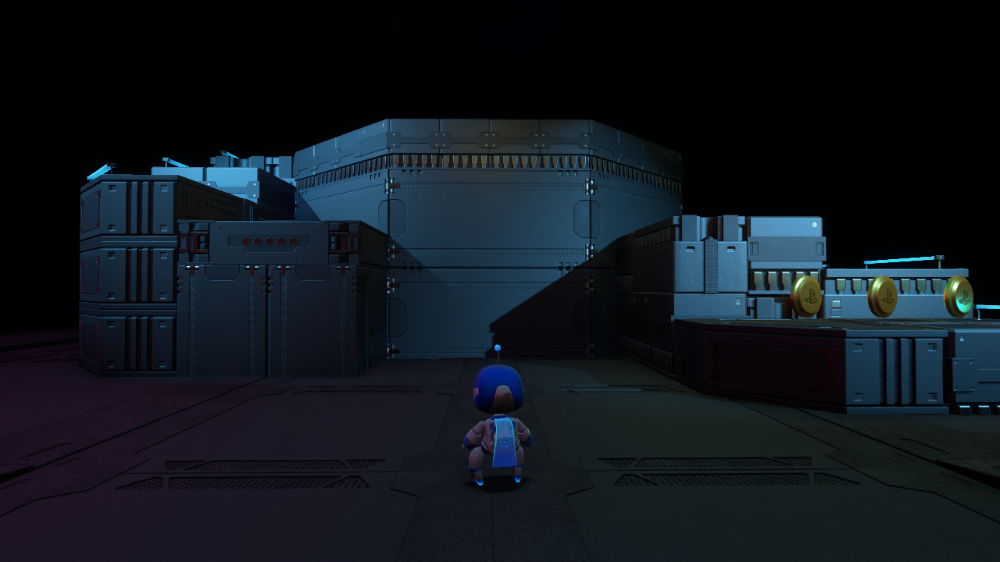

# kyty-astro-loopguard

**ASTRO's Playroom masuk game mode @ 2–3 fps — Linux Xubuntu, Radeon RX 5700 (RDNA1).**

Patch **loop guard** untuk [Kyty](https://github.com/InoriRus/Kyty) (PS5 emulator) yang
menghentikan **GPU hang** saat level loading — sekarang game **bisa dimainkan**
(Astro Bot berjalan di level), bukan lagi hang di frame ~4.400.



> 🤖 **Semua edit (patch kode, script, dokumen) dilakukan oleh AI — DeepSeek V4.1 Flash**
> (model `deepseek-v4.1-flash-free`, via [OpenCode](https://opencode.ai)).

---

## Status (15 Okt 2026)

| | |
|---|---|
| Game | ASTRO's PLAYROOM (`PPSA01325`) |
| Emulator | Kyty @ `99358054` + patch di repo ini |
| OS | **Xubuntu / Linux** (X11) |
| CPU | Xeon E3-1230 v3 |
| GPU | AMD Radeon RX 5700 8 GB (**RDNA1 / Navi10**) |
| Driver | RADV (Mesa), `VK_ICD_FILENAMES=radeon_icd.json` |
| Hasil | ✅ **Masuk gameplay** (tanpa GPU hang), frame ~6.000+ |
| FPS | **2–3 fps** saat kompilasi shader berjalan (naik setelah semua shader dikompilasi) |

---

## Masalah & solusi singkat

1. Shader compute guest (vider: BVH traversal) memiliki **loop yang tidak pernah
   selesai** di RDNA1 — keluar loop tergantung ballot wave-wide yang tidak terpenuhi
   → wave berputar → **GPU hang** (`vkQueueSubmit failed: ErrorDeviceLost (-4)`).
2. Kyty **tidak punya** mekanisme fault-retry/redispatch, jadi dispatch yang nyangkut
   tidak pernah bisa di-recover. Satu-satunya jalan: batasi loop di level emitter.
3. **Loop guard** (patch di repo ini): setiap loop header guest diberi counter
   iterasi per-lane; setelah `KYTY_LOOP_GUARD_LIMIT` iterasi, **semua cabang keluar
   loop yang sudah ada "diracuni"** (`cond || over` / `cond && !over`) → keluar
   graceful, tanpa menambah blok/cabang baru (aman untuk `OpPhi` & validator SPIR-V).
4. **Limit 1.000.000 (default build) masih hang** di GPU ini: total kerja
   (jumlah wave × 1 juta iterasi) melewati timeout hang RADV (~10 s) → tetap
   dianggap hang. **Solusi: `KYTY_LOOP_GUARD_LIMIT=50000`** (launcher sudah set).

Bukti sebelum/sesudah (register dump RADV):

| | `GRBM_STATUS` | Arti |
|---|---|---|
| Sebelum patch | `0xa0407028` | `TA_BUSY=1, SPI_BUSY=1, CP_BUSY=1` → **wave spin** |
| Sesudah patch | `0x00003028` | semua idle → guard bekerja, tidak ada wave yang spin lagi |

---

## Cara pakai

```bash
# 1) Ambil binary siap pakai dari Release v1.0:
#    https://github.com/tyyyyyyyyyyyyyyyy/kyty-astro-loopguard/releases/tag/v1.0
#    (atau build ulang — lihat bawah)
# 2) Jalankan (launcher sudah set env + argumen yang benar):
KYTY_LOOP_GUARD_LIMIT=50000 ./patches/run_astro_loopguard.sh
```

> ⚠️ **Wajib** `KYTY_LOOP_GUARD_LIMIT=50000` (atau nilai kecil lain). Tanpa itu,
> default build = 1.000.000 → **masih hang** di RX 5700.
>
> 📝 Script launcher di repo memakai path mesin asli (`/mnt/share/tyo`,
> `/mnt/ulfa/astrobot/PPSA01325`) — sesuaikan dengan mesin Anda.
> Tombol: `j` = ✕/Cross (di "PRESS ANY BUTTON" dan menu "Continue").

### Build ulang dari source `kyty_latest` (HEAD `99358054`)

```bash
python3 patches/2026-10-15_loopguard/loopguard_v2.py   # restore .bak + apply patch
ninja -C build kyty_emulator -j$(nproc)                # hasil: build/kyty_emulator
```

Script `loopguard_v2.py` idempoten (selalu restore dulu dari `*.loopguard.bak`).

---

## Isi repo

```
README.md                                    ← dokumen ini
docs/FINDINGS.md                             ← temuan lengkap (Bahasa Indonesia)
docs/EVIDENCE.md                             ← ringkasan bukti dump (GRBM, validator)
patches/
  2026-10-15_loopguard/
    loopguard_v2.py                          ← script patch (idempoten)
    loopguard_internal.diff                  ← diff spirvEmitterInternal.h
    loopguard_program.diff                   ← diff spirvEmitterProgram.cpp
    spirvEmitterInternal.h                   ← file hasil patch (referensi)
    spirvEmitterProgram.cpp                  ← file hasil patch (referensi)
    vulkanWindow.cpp                         ← file hasil patch barycentric fix (referensi)
    analyze_guard.py                         ← analisis guard per-loop dari dump .spv
    lg_mon3.sh                               ← monitor run (frame/fps/GPU/CPU)
    BUILD.sha256                             ← SHA-256 binary release
  run_astro_loopguard.sh                     ← launcher
  pressj.sh                                  ← auto-press ✕ (opsional)
screenshots/astro-gameplay.png               ← bukti masuk gameplay
licenses/                                    ← lisensi upstream Kyty (GPL-2.0 / MIT)
```

---

## Detail lengkap

Baca **[docs/FINDINGS.md](docs/FINDINGS.md)** — analisis lengkap (Bahasa Indonesia):

- rantai akar masalah & desain loop guard (termasuk **jebakan validator SPIR-V**
  `ValidateStructuredSelections` yang memaksa desain v2),
- bukti register dump RADV sebelum/sesudah,
- resep run lengkap, daftar file yang diubah, dan status run 17:18/17:28.

## Lisensi

- Kode patch di repo ini adalah *derivative work* dari **Kyty** (© InoriRus) —
  ikuti lisensi upstream: **GPL-2.0**, sebagian komponen MIT.
  Salinan lisensi upstream ada di [`licenses/`](licenses/).
- Konten game (ASTRO's Playroom) **tidak** termasuk di repo ini.
- Binary di Release dibangun dari Kyty `99358054` + patch di repo ini.
